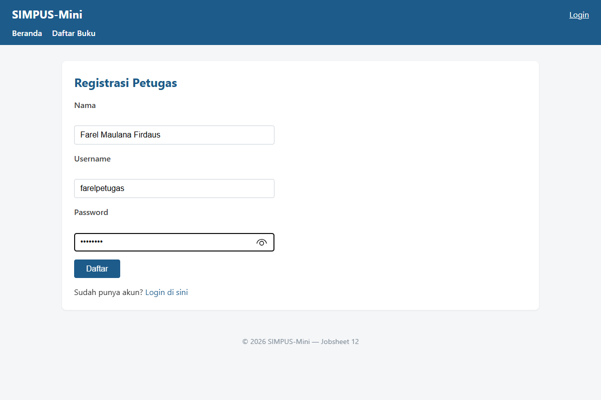
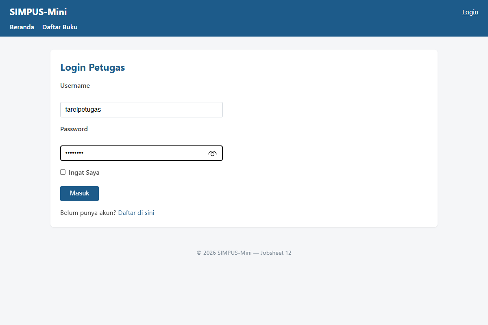
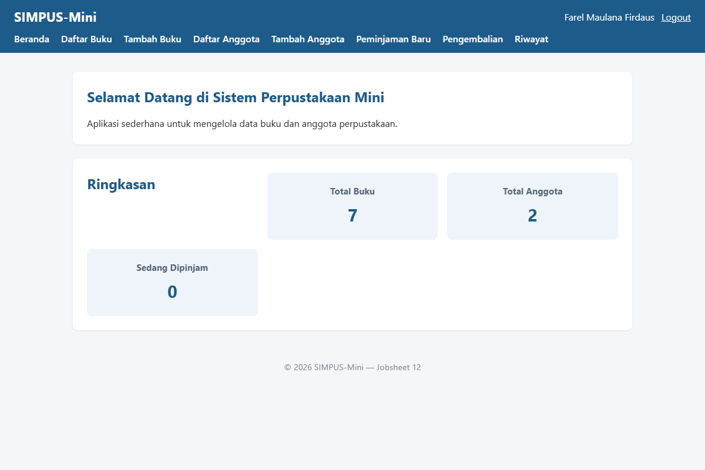
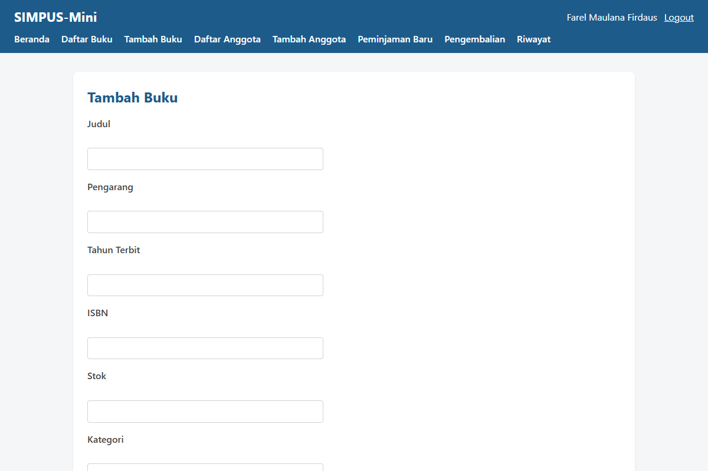
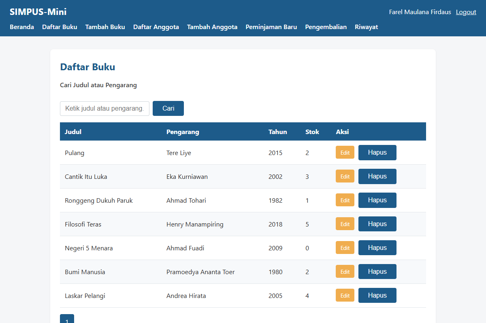
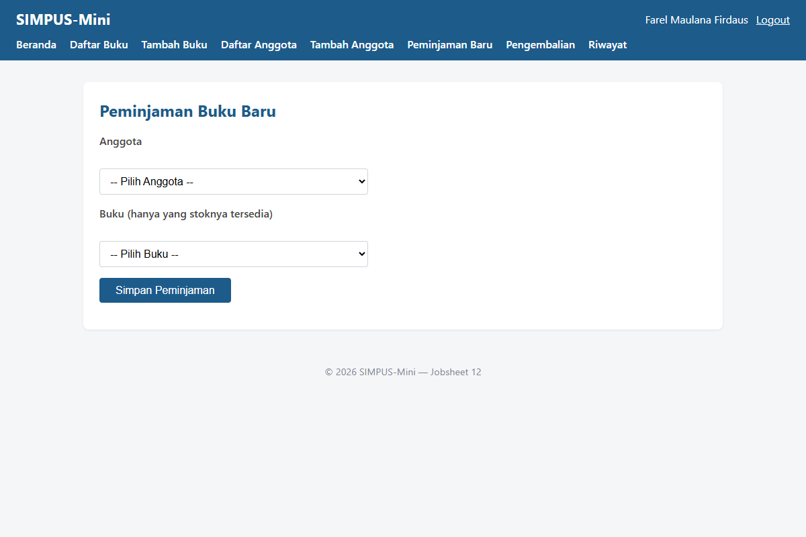
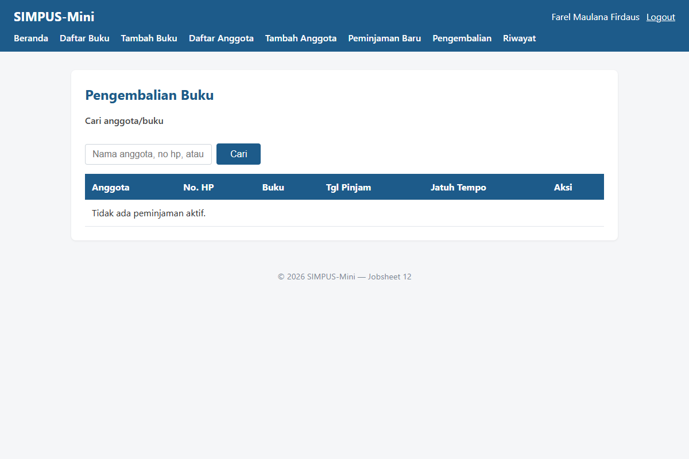
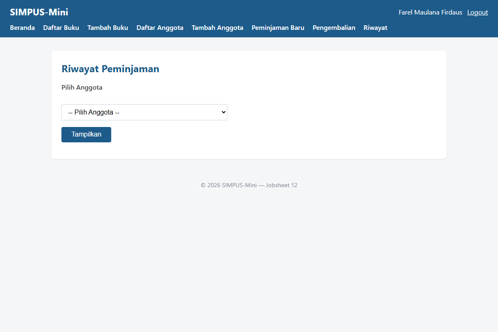

# Manual Pengguna — SIMPUS-Mini

Dokumen panduan operasional pengguna aplikasi SIMPUS-Mini dengan tangkapan layar nyata dari server aplikasi aktif.

---

## 1. Registrasi & Login Petugas

1. Buka `http://localhost:8000/auth/register.php`.
2. Isi Nama, Username, dan Password (minimal 6 karakter), lalu klik **Daftar**.
   

3. Setelah berhasil mendaftar, buka halaman Login di `http://localhost:8000/auth/login.php`. Masukkan username & password yang baru dibuat, lalu klik **Masuk**.
   

4. Setelah login berhasil, navbar menampilkan status akun petugas aktif (`Farel Maulana Firdaus`), tombol **Logout**, serta hak akses menu tambahan (Tambah Buku, Tambah Anggota, Peminjaman Baru, Pengembalian, Riwayat) yang tidak dapat diakses oleh Tamu biasa.
   

---

## 2. Mengelola Data Buku

1. Klik menu **Tambah Buku** (`http://localhost:8000/buku/tambah.php`), lengkapi field Judul, Pengarang, Tahun, ISBN, Stok, dan Kategori, lalu klik **Simpan**.
   

2. Data buku baru akan langsung tercatat dan dapat dilihat pada **Daftar Buku** (`http://localhost:8000/buku/list.php`). Terdapat fitur pencarian real-time dan opsi Edit serta Hapus.
   

---

## 3. Mengelola Data Anggota

Alur pengelolaan anggota sama dengan katalog buku:
- Akses menu **Tambah Anggota** (`/anggota/tambah.php`) untuk memasukkan Nama, No. Anggota, Alamat, dan Nomor HP.
- Seluruh anggota terdaftar akan tersaji di **Daftar Anggota** (`/anggota/list.php`) lengkap dengan aksi Edit dan Hapus.

---

## 4. Meminjamkan Buku

1. Klik menu **Peminjaman Baru** (`http://localhost:8000/peminjaman/tambah.php`).
2. Pilih nama **Anggota** dan **Buku** dari dropdown pilihan (sistem otomatis hanya menampilkan buku yang memiliki stok > 0).
3. Klik tombol **Simpan Peminjaman**. Sistem secara atomik mengunci baris buku (`FOR UPDATE`), memeriksa batasan keterlambatan >14 hari, mencatat transaksi peminjaman baru, dan memotong stok buku sebesar 1.
   

---

## 5. Mengembalikan Buku

1. Klik menu **Pengembalian** (`http://localhost:8000/peminjaman/kembali.php`).
2. Cari transaksi aktif berdasarkan nama anggota atau judul buku. Klik tombol **Kembalikan** pada baris transaksi yang bersangkutan.
3. Transaksi diperbarui menjadi selesai dan stok buku otomatis bertambah kembali 1 ke inventaris perpustakaan.
   

---

## 6. Melihat Riwayat Peminjaman

1. Klik menu **Riwayat** (`http://localhost:8000/peminjaman/riwayat.php`).
2. Pilih nama anggota dari dropdown, kemudian klik **Tampilkan**.
3. Tabel multi-table JOIN akan menampilkan histori transaksi lengkap beserta status peminjaman (Dipinjam / Selesai).
   

---

## 7. Logout

Klik tombol **Logout** di navbar kanan atas untuk menghancurkan sesi autentikasi secara aman (`session_destroy`). Pengguna akan dialihkan kembali ke tampilan publik/tamu, dan hak akses transaksi terlindungi dari akses ilegal.
